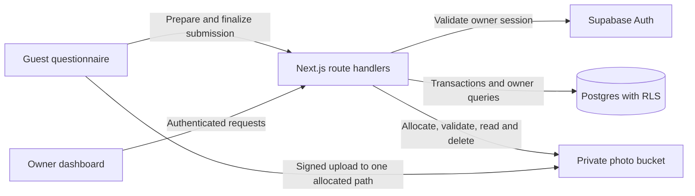

# Raghav’s Slambook

A private, single-owner slam book. Friends follow a shared link, complete a four-part questionnaire, preview their answers, and optionally attach photos without creating an account. The owner signs in to search, read, export, and delete entries or pause new submissions.

The application supports two separate storage modes: a local JSON/file demo on port **6001**, and a production backend using **Supabase Postgres, Auth, and private Storage**. Submitted entries are never listed on the public homepage.

## Contents

- [Stack and runtime](#stack-and-runtime)
- [Architecture](#architecture)
- [Run locally](#run-locally)
- [Supabase and environment setup](#connect-supabase)
- [Deployment](#deploy-to-vercel)
- [API reference](#api-reference)
- [Data model](#data-model)
- [Behaviour and privacy](#behaviour-and-privacy)
- [Cleanup](#rate-limiting-and-cleanup) and [exports](#exports)
- [Commands and verification](#verify)
- [Troubleshooting](#troubleshooting)
- [Source map and customization](#source-map)

## Stack and runtime

| Layer                                | Implementation                                                                            |
| ------------------------------------ | ----------------------------------------------------------------------------------------- |
| Runtime                              | Node.js 22; npm with the committed `package-lock.json`                                    |
| Web application                      | Next.js 16.4.6 App Router; React 19.3.1; TypeScript 5.9                                   |
| Persistence and owner authentication | Supabase Postgres, Auth, Storage; `@supabase/ssr` cookie sessions                         |
| Validation                           | Shared Zod schemas, database constraints, and transactional SQL functions                 |
| Images and archives                  | Browser canvas preparation; Sharp server validation; fflate ZIP streaming                 |
| UI                                   | CSS Modules/global tokens, self-hosted DM Sans, native WebGL 2 Aurora with a CSS fallback |
| Tests                                | Node test runner, PGlite, and Playwright                                                  |
| Deployment configuration             | Vercel, including a daily authenticated cleanup route                                     |

The application requires a **Node.js server runtime** for route handlers, Sharp, and private server credentials. It is not a static export. Exact dependency resolutions are recorded in [package-lock.json](package-lock.json); use `npm ci` for reproducible installs.

## Architecture



Public pages and shared layout render through the App Router. `SignForm` and `AdminApp` own browser interactions; server-only modules perform privileged database and storage operations. `src/proxy.ts` refreshes owner-page sessions, while every private API route independently checks ownership.

The submission flow is designed to survive lost responses:

1. The browser creates a random request UUID and a 32-byte attempt token. It saves text and the attempt proof in local storage; selected photo files stay in memory.
2. `POST /api/uploads` validates the manifest, checks submissions are open, and atomically allocates storage paths through `prepare_uploads`. The database stores a SHA-256 hash of the attempt token.
3. Prepared images upload directly to their signed paths. Retrying reuses files already present. The browser cannot choose storage paths or overwrite an uploaded object.
4. `POST /api/submissions` verifies the attempt, downloads and decodes the selected photos, and marks their upload rows verified.
5. `finalize_entry` creates the entry and ordered media records in one transaction. A completed attempt returns its previous success receipt rather than inserting a duplicate.
6. The browser validates the success acknowledgement, shows confirmation, and clears only the matching local draft.

Demo mode routes the same application services to `DemoStore`, a serialized, atomically replaced JSON store with local media files. It never connects to Supabase and is not a production storage option.

## Run locally

Use Node.js 22 LTS and npm.

From a fresh checkout, run the following commands from the repository root.

To try a working local demo with six fictional entries and no account or Supabase configuration:

```bash
npm ci
npm run demo
```

Open [localhost:6001](http://localhost:6001), [sign the book](http://localhost:6001/sign), or [open the owner dashboard](http://localhost:6001/admin). New test entries, photos, and settings persist in the ignored `.local-demo/` folder. The demo binds to this computer only. It does not connect to Supabase, and its owner sign-in bypass is disabled in production and on Vercel. Stop the server and remove `.local-demo/` to reset only the sample data. `npm run dev -- --demo` starts the same demo.

The demo validates its saved state before modifying it. Failed photo deletions remain queued in that file and retry on subsequent requests, including after a restart.

To use another loopback port or a separate disposable data directory:

```bash
npm run demo -- --port 6002
SLAMBOOK_DEMO_DIR=/tmp/slambook-demo npm run demo
```

Do not use the live `.local-demo/` directory for automated tests you want to discard. The demo owner dashboard deliberately has no sign-in; the server requires development mode, rejects Vercel, and binds to loopback only.

For the real Supabase-backed app:

```bash
npm ci
cp .env.example .env.local
npm run dev
```

Open `http://localhost:3000`. The welcome page, questionnaire, local drafts, photo preparation, and preview can be explored before Supabase is configured. The app clearly says that sending and owner sign-in are unavailable; it never pretends to save a submission.

## Connect Supabase

1. Create a dedicated Supabase project. In SQL Editor, run both migrations in order:
   - `supabase/migrations/202611240001_slambook.sql`
   - `supabase/migrations/202611240002_cleanup.sql`
2. In Authentication → Users, create the owner using an email and password. Confirm the email for this manually provisioned account. Disable public user sign-ups and anonymous sign-ins; visitors use server endpoints, not Supabase Auth.
3. Copy that user’s UUID into `OWNER_USER_ID` in `.env.local`, and configure the same UUID in Postgres:

   ```sql
   update public.settings
   set owner_id = 'YOUR-OWNER-AUTH-UUID'::uuid
   where id = 1;
   ```

4. Fill in the remaining values in `.env.local`:

   | Variable                               | Purpose                                               | Required                |
   | -------------------------------------- | ----------------------------------------------------- | ----------------------- |
   | `NEXT_PUBLIC_SUPABASE_URL`             | Project URL                                           | Supabase mode           |
   | `NEXT_PUBLIC_SUPABASE_PUBLISHABLE_KEY` | Publishable key or legacy anon key                    | Supabase mode           |
   | `SUPABASE_SERVICE_ROLE_KEY`            | Privileged service-role key; server only              | Supabase mode           |
   | `OWNER_USER_ID`                        | Owner Auth UUID, matching `settings.owner_id`         | Supabase mode           |
   | `APP_ORIGIN`                           | Exact browser origin; locally `http://localhost:3000` | Supabase mode           |
   | `RATE_LIMIT_SECRET`                    | Independent random secret; use at least 32 bytes      | Supabase mode           |
   | `CRON_SECRET`                          | Independent random secret used to authorize cleanup   | Scheduled cleanup       |
   | `TRUSTED_IP_HEADER`                    | Header overwritten by your reverse proxy              | Optional outside Vercel |

   Run `openssl rand -hex 32` separately for each random secret. Never commit `.env.local` or put privileged keys in `NEXT_PUBLIC_*` variables.

5. Restart the development server. Sign in at `/admin`. The owner can edit the welcome message without changing code.

The migrations create `slambook-photos` as a **private** bucket with a 2 MB file limit and a JPEG/PNG/WebP allowlist. Do not make the bucket public or add anonymous `storage.objects` policies. Use a dedicated project or audit existing broad storage policies: policies from another app must not grant access to this bucket.

For a forgotten owner password, reset it through the Supabase dashboard. This V1 intentionally has no registration flow or public account management.

The two SQL files are ordered migrations, not an idempotent seed script: apply each once to a new project. Add a new migration for subsequent schema changes rather than rerunning the original table definitions against an existing database.

## Deploy to Vercel

1. Put this source in your repository and import it as a Next.js project in Vercel. Use Node.js 22 and `npm run build`.
2. Set all the variables above in the deployment environment. Set `APP_ORIGIN` to the exact HTTPS production origin, without a path. A preview deployment needs its own matching origin; do not use a broad origin wildcard.
3. Apply the migrations to the production Supabase project and configure its owner UUID before accepting submissions. Keep preview/testing data separate from the live book.
4. Deploy. Check `/`, `/sign`, and owner sign-in at `/admin`. Share **`https://your-domain/sign`** with friends. The homepage also links there.
5. Confirm the daily cleanup job appears in Vercel’s Cron Jobs screen and runs successfully. `vercel.json` schedules `/api/cron/cleanup` at `03:15 UTC` daily. Vercel attaches `Authorization: Bearer <CRON_SECRET>`; unauthorised requests are rejected. See [Vercel’s cron security documentation](https://vercel.com/docs/cron-jobs/manage-cron-jobs#securing-cron-jobs).

The export route streams a ZIP and allows up to 300 seconds; cleanup allows 60 seconds. Confirm these limits against your selected Vercel plan. Verify current [Supabase quotas](https://supabase.com/pricing), storage transfer usage, project inactivity behaviour, and Vercel limits before launch. The PRD’s old free-plan quotas are not assumed current. Maintain regular downloaded exports; the hosted database is not the only archive.

For another Node.js host, run `npm run build` followed by `npm start`. Configure HTTPS, the exact `APP_ORIGIN`, and an external scheduler for `GET /api/cron/cleanup` with the bearer secret. The application does not start its own background scheduler. Keep production and preview secrets in the hosting environment, not in Git.

## API reference

Send JSON payloads with `Content-Type: application/json`. Browser mutation routes check that `Origin` matches `APP_ORIGIN`. Guest writes also require an attempt proof; owner operations require the configured owner's cookie session. The binary demo upload uses the image's MIME type instead. Normal JSON responses use `Cache-Control: private, no-store`.

| Method | Route                                           | Access                      | Contract                                                                                                      |
| ------ | ----------------------------------------------- | --------------------------- | ------------------------------------------------------------------------------------------------------------- |
| GET    | `/api/settings`                                 | Public                      | `{ available, submissions_open, welcome_text }`                                                               |
| POST   | `/api/uploads`                                  | Guest + origin              | `{ requestId, attemptToken, files: [{ id, size, mime }] }` → `{ submitted, files: [{ id, uploaded, url? }] }` |
| POST   | `/api/submissions`                              | Guest + origin              | `{ requestId, attemptToken, entry, media: [{ id, caption }], website?: "" }` → `{ submitted: true }`          |
| POST   | `/api/auth/login`                               | Origin + rate limit         | `{ email, password }` → session cookies and `{ ok: true }`                                                    |
| POST   | `/api/auth/logout`                              | Origin                      | Signs out the current authenticated session; `{ ok: true }` only on success                                   |
| GET    | `/api/admin/session`                            | Owner                       | `{ settings, demo }`                                                                                          |
| GET    | `/api/admin/entries?q=&page=1`                  | Owner                       | Literal name/nickname search; 12 entries per page; `{ entries, total, page }`                                 |
| GET    | `/api/admin/entries/:id`                        | Owner                       | `{ entry }`, including ordered media metadata                                                                 |
| DELETE | `/api/admin/entries/:id`                        | Owner + origin              | `{ deleted: true, photosRemoved }`; false means storage deletion remains queued                               |
| PATCH  | `/api/admin/settings`                           | Owner + origin              | Non-empty subset of `{ submissions_open, welcome_text }` → `{ ok: true }`                                     |
| GET    | `/api/admin/media/:id`                          | Owner                       | Uncached private image bytes; no public download URL                                                          |
| GET    | `/api/admin/export?id=<uuid>`                   | Owner                       | ZIP of one entry, or the entire book when `id` is omitted                                                     |
| GET    | `/api/cron/cleanup`                             | Cron bearer secret          | `{ ok: true, removed }`                                                                                       |
| PUT    | `/api/demo/uploads/:id?requestId=...&token=...` | Local demo + origin + proof | Validated image bytes → `{ uploaded: true }`; returns 404 outside demo mode                                   |

Payload definitions and bounds live in [src/lib/questions.ts](src/lib/questions.ts). Both the browser and server validate their relevant input/response schemas. JSON bodies are capped at 98,304 bytes independently of a supplied `Content-Length` header.

Errors use `{ error, code?, fields? }`. Validation failures return 400 with dotted field paths; owner authentication/authorization failures return 401/403. A closed book returns 409, expired attempts return 410, and throttling returns 429 with `Retry-After: 3600`. The browser preserves answers and reuses its attempt when retrying an interrupted save; expired or invalid attempts receive a fresh proof. Browser JSON requests time out after 30 seconds, or 70 seconds for final submission; photo uploads have a 120-second timeout.

## Data model

| Table                 | Purpose and important constraints                                                                                                    |
| --------------------- | ------------------------------------------------------------------------------------------------------------------------------------ |
| `settings`            | Singleton row `id = 1`; owner UUID, submission toggle, and welcome text                                                              |
| `entries`             | Answers as JSONB, questionnaire version, private contact handle, creation time, and deletion tombstone; unique submission request ID |
| `submission_attempts` | Request UUID, token hash, 24-hour expiry, and durable completion receipt                                                             |
| `upload_files`        | Server-allocated path, declared MIME/size, active selection and verification flags; belongs to one attempt                           |
| `entry_media`         | Joins a committed entry to an upload; caption and unique position 0–2 within the entry                                               |
| `rate_limits`         | HMAC-derived key, fixed-window start, and atomic hit counter                                                                         |

`prepare_uploads`, `finalize_entry`, and `consume_rate_limit` handle allocation, commit, and throttling transactionally. `abandoned_uploads` and `prune_empty_attempts` support cleanup. Mutating/internal RPCs are executable only by `service_role`. `is_book_owner` is the authenticated read-policy helper.

All six application tables have RLS enabled. Owner read policies are limited to settings, active entries, and their media. Anonymous table access yields no private records; authenticated non-owners receive no records either. Insert/update/delete access is through validated server endpoints, not browser table writes. The dedicated private bucket is `slambook-photos`.

The questionnaire currently uses version **1**. Changing stored answer keys or version semantics requires a database migration and corresponding validation/rendering changes; changing a display label alone does not.

## Behaviour and privacy

| Route                 | Purpose                                                                                |
| --------------------- | -------------------------------------------------------------------------------------- |
| `/`                   | Personal welcome; never contains submitted entries                                     |
| `/sign`               | Four form sections, preview, upload progress/retry, confirmation                       |
| `/admin`              | Owner sign-in, search by name/nickname, pagination, export, welcome note, close/reopen |
| `/admin/entries/[id]` | Owner-only entry/photos, individual export and deletion                                |

- Text is stored in this browser’s local storage with a versioned draft and a random attempt ID/proof. “Start fresh” resets them after confirmation and is disabled while submitting or preparing photos. A validated success clears only the matching draft; a late response does not clear newer saved text or another attempt. Photos are kept in memory and must be reselected after a refresh. A storage failure is shown explicitly. On a shared device, reset the draft or clear site data when finished.
- Name, how you met, and favourite memory are required. Other questions and up to three photos are optional. Server schemas enforce field keys, lengths, identifiers, counts, and types.
- Browser image processing strips metadata, resizes to at most 2,000 pixels on the longer side, and targets 500 KB. It converts supported photos to JPEG, with a white background for transparency. Original images over 20 MB or 40 megapixels are rejected before canvas allocation. HEIC, SVG, GIF, audio, and video are not accepted.
- Upload authorisation allocates paths in Postgres. The browser receives a token for each exact path and uploads directly to Supabase Storage. Tokens cannot overwrite files. No privileged key or image blob is stored in the application database.
- The server downloads at most three bounded files to validate their real format, declared size, pixel count, and decodability. A transaction creates the entry and media records only after all photos are verified. Retrying a successful attempt acknowledges it without making another record; deliberate new attempts may use the same name.
- Auth is verified against Supabase using `getUser()`, then checked against both `OWNER_USER_ID` and the settings owner. An arbitrary authenticated user is not an owner. All application tables have RLS, and guest mutations require validated server endpoints. Internal SQL functions are executable only by `service_role`.
- Photos are delivered through an authenticated, uncached owner endpoint. Public or bearer download URLs are never exposed. Deleting an entry first hides it from all entry/media reads, then removes its objects. A storage outage leaves a durable deletion marker for cleanup to retry.
- Closing submissions is checked in both upload allocation and finalisation transactions, including already-started attempts. A retry of a previously completed submission can still receive its success acknowledgement.
- There is no contributor identity verification: anyone with a forwarded link can submit. Future public featuring requires separate permission and a future implementation; V1 has no public entries, publishing controls, or public media policies.

## Rate limiting and cleanup

Limits live in Postgres, not process memory. Upload-authorisation and submission endpoints each allow 30 requests per trusted IP per hour; owner login allows 10. The fixed-window counters increment atomically. IPs are HMAC-hashed with `RATE_LIMIT_SECRET`, and old counters are pruned after 48 hours. Database/rate-limit failures fail closed.

On Vercel, the app uses the platform-overwritten `x-vercel-forwarded-for` header. Other deployments default to a shared limiter key. Only set `TRUSTED_IP_HEADER` behind a proxy that **overwrites** that header; never trust a client-supplied forwarding header. Adjust endpoint limits in `src/lib/http.ts` after observing actual use. No CAPTCHA is required for V1.

Attempts expire after 24 hours. At most three photo slots are active, with at most 12 allocated over an attempt’s lifetime to bound abandoned replacements. Removed slots remain tracked. Cleanup waits at least 26 hours from attempt creation, covering the attempt lifetime and the last two-hour upload token. It deletes only files unreferenced by entries, retries marked deletions, and prunes empty incomplete attempts. Completed attempt receipts are retained so a retry cannot resurrect a deleted entry.

The daily job processes up to 100 abandoned uploads and 50 marked entries per run. For an unusual backlog, run additional authenticated invocations or increase the schedule on a supported plan. Monitor cleanup responses and storage usage. Never delete objects directly through `storage.objects` SQL: the Storage API must remove the actual bytes.

## Exports

“Export book” downloads a private ZIP. “Export this page” exports one entry. The ZIP contains:

- `entries.json`: answers, questionnaire version, private contact handle, dates, and photo IDs.
- `manifest.json`: each entry/photo ID, caption, size/type, sort order, and relative archive filename.
- `photos/<entry-id>/<photo-id>.<extension>`: the actual stored photo bytes.
- `README.txt`: archive format and privacy reminder.

Photos stream sequentially with backpressure instead of buffering the entire archive. Missing photos and incorrect byte counts fail the download instead of silently producing an incomplete archive. Cancellation aborts the active photo download. Entry pagination resumes after the last timestamp and ID so deleting earlier entries cannot shift later pages out of the export. Avoid deleting entries during an export: deleting a selected photo can still interrupt its download. Exports are private records, not permission to publish contributions.

## Verify

| Command                                                  | Purpose                                                       |
| -------------------------------------------------------- | ------------------------------------------------------------- |
| `npm run dev`                                            | Development app, default port 3000                            |
| `npm run demo`                                           | Persistent local demo, default port 6001                      |
| `npm run build`                                          | Production build                                              |
| `npm start`                                              | Serve the production build                                    |
| `npm run check`                                          | Generate Next route types and run strict TypeScript checks    |
| `npm test`                                               | All top-level unit/database test files, without live Supabase |
| `npm run test:e2e`                                       | Main Playwright suite; manages a dev server on port 3100      |
| `npm run test:e2e -- --config=playwright.demo.config.ts` | Demo browser suite; requires the demo already running on 6001 |
| `npm run verify`                                         | Type checking, unit/database tests, then production build     |
| `node scripts/check-contrast.mjs`                        | Calculate chapter-card text contrast bounds from CSS          |

```bash
npm run check
npm test
npm run build
npm run test:e2e
```

The latest code review recorded **44 passing unit/database tests**, strict TypeScript checks, and a production webpack build. Sixteen main browser tests are registered, but the four recently added regression cases have not run in this sandbox. See [docs/verification.md](docs/verification.md) for the distinction between executed checks, earlier browser runs, and outstanding live-service/device checks. For environments where Turbopack cannot run, the equivalent production command is `npm run build -- --webpack`.

Browser tests use installed Chrome when `/usr/bin/google-chrome` exists, otherwise Playwright’s Chromium. Set `CHROMIUM_PATH` for another local Chrome binary, or install Chromium with `npx playwright install chromium`. The suite owns port 3100 and generates screenshots under `artifacts/`.

- Database tests execute the actual migrations in PGlite (Postgres), with Supabase roles, `auth.uid()`, and bucket metadata stubbed. They exercise RLS for anonymous/non-owner/owner users, idempotency, deliberate repeat names, wrong attempt tokens, expiry, closed submissions, upload ownership/counts, verification before commit, deletion visibility, persistent rate limits, and abandoned-file selection.
- Schema/media/export tests reject invalid payloads and corrupt or mismatched image bytes, inspect ZIP contents, and exercise export cancellation and deletion during pagination. Search tests execute escaped literal patterns in Postgres and inspect SDK query serialization.
- Browser API and draft unit tests cover malformed acknowledgements, timeouts, cancellation, header handling, and late responses that must preserve a newer draft.
- Local demo tests cover persistence, concurrent writes, retry/deletion receipts, image storage, incompatible state, durable photo-cleanup retries, closed submissions, and the development-only switch. With the demo running on 6001, `npm run test:e2e -- --config=playwright.demo.config.ts` checks real local submission, photo, export, and owner flows without mocked API responses.
- Browser tests exercise validation/focus, refresh/reset, image preparation, captions, preview, interrupted submission/retry, malformed acknowledgements, reset during submission, draft clearing, stale owner reads, pagination recovery, and layouts at 320, 375, 390, 768, and 1440 CSS pixels. Guest submission/storage and owner data responses are mocked for UI tests. Anonymous API protection is checked against real Next.js handlers. Newly added cases still require browser execution; see the verification record below.

This repository does not include Supabase or Vercel credentials. Actual hosted Auth/Storage, cron delivery, and deployment must be verified after setup. Desktop Chromium with resized viewports is **not** a claim of testing real iOS Safari or Android Chrome. Before sharing, exercise gallery selection, on-screen keyboard scrolling, poor-network retries, and the complete flow on both physical devices. See [docs/verification.md](docs/verification.md) for the recorded results and remaining checks.

## Troubleshooting

| Symptom                                     | Check                                                                                                                                                                     |
| ------------------------------------------- | ------------------------------------------------------------------------------------------------------------------------------------------------------------------------- |
| Sending is unavailable                      | Configure all six application variables required by `isConfigured()`, apply the migrations, and restart the server. `CRON_SECRET` is additionally needed for cleanup.     |
| Owner sign-in succeeds but access is denied | Match the Auth UUID in both `OWNER_USER_ID` and `public.settings.owner_id`; verify the Auth account is confirmed.                                                         |
| A mutation returns 403                      | Use the exact configured origin. `localhost` and `127.0.0.1`, or different ports, are distinct origins.                                                                   |
| Local demo is unavailable on another device | It intentionally binds only to loopback. Use the Supabase-backed deployment for shared access.                                                                            |
| Photo selection fails                       | Use JPEG, PNG, or WebP. Originals must be at most 20 MiB and 40 megapixels; HEIC needs conversion first.                                                                  |
| Selected photos disappear after refresh     | Only text and attempt metadata persist in local storage. Reselect photo files before sending.                                                                             |
| Demo reports that saved data needs repair   | Back up `.local-demo/` and inspect `state.json`; incompatible or malformed state is left intact. Delete the directory only when intentionally discarding that local data. |
| Export fails during download                | Retry after storage recovers; do not delete its selected photos while exporting. Missing or truncated files fail the archive visibly.                                     |
| Development page repeatedly refreshes       | Keep the default Next dev indicator. `devIndicators: false` previously triggered a Turbopack reload loop in the installed version.                                        |
| Playwright cannot launch Chrome             | Install Chromium with `npx playwright install chromium`, set `CHROMIUM_PATH`, or run in an environment that permits browser processes.                                    |

## Source map

```text
src/app/                 Public/owner pages, API handlers, metadata and global CSS
src/components/          Questionnaire, owner UI, entry rendering and shared visuals
src/components/aurora/   React Bits Aurora implementation and fallback CSS
src/lib/                 Schemas, auth, Supabase clients, submission/storage services
src/proxy.ts             Owner-page session refresh
supabase/migrations/     Ordered schema, RLS, RPC and cleanup migrations
scripts/                 Dev/demo launcher, contrast calculations and screenshot utility
tests/                   Unit/database tests and browser suites
docs/verification.md     Review findings, executed checks and verification limits
vercel.json              Scheduled cleanup and function duration configuration
.env.example             Placeholder environment configuration; no credentials
```

Customize text and answer definitions in `src/lib/questions.ts`, the cover and permanent yellow welcome strip in `src/app/page.tsx`, and the live welcome note through the owner dashboard. Global type/color tokens are in `src/app/globals.css`; the four shared UI sizes are 14, 16, 24, and 36 pixels at the default root size. The cover has a separate responsive display size.

Aurora palettes and speeds are configured in `src/components/aurora-background.tsx`. The component is adapted from the supplied [React Bits Aurora](https://reactbits.dev/backgrounds/aurora), uses native WebGL 2 without an extra rendering dependency, pauses offscreen/in hidden tabs, and respects reduced motion. Grain stays behind content; chapter cards use solid pastel bases. The yellow cover strip remains in production with personal copy, while demo mode displays the local-data notice.

Source requirements: [product requirements](Slam_Book_PRD.md) and [design guidelines](DESIGN%282%29.md). Generated builds, dependencies, screenshots, local entries/photos, and environment secrets are excluded by [.gitignore](.gitignore). This repository contains application source, not a backup of a live book. ZIP exports are the data archive; there is currently no in-app import or restore workflow and no public entry gallery.
