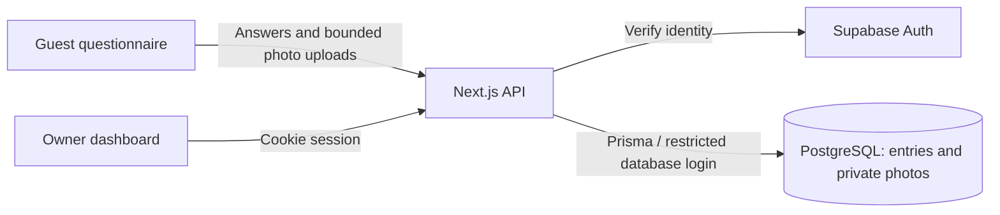

# Raghav’s Slambook

A private, single-owner slam book. Friends follow a link, answer a four-part questionnaire, preview their entry, and optionally add photos **without signing in**. The owner signs in to read, search, export, delete entries, or pause submissions. Entries never appear on the public homepage.

Production uses **Prisma 7, Supabase PostgreSQL, and Supabase Auth**. Small photos are stored as private database bytes, so the app needs **no Supabase service-role key**. A separate local demo uses JSON/files and fictional entries.

## Stack

| Layer             | Implementation                                         |
| ----------------- | ------------------------------------------------------ |
| Runtime           | Node.js 22, npm with a committed lockfile              |
| Web               | Next.js 16.4.6 App Router, React 19, TypeScript        |
| Database          | Prisma 7.10.1, PostgreSQL, Supabase transaction pooler |
| Owner sessions    | Supabase Auth and `@supabase/ssr`                      |
| Validation        | Zod, PostgreSQL constraints, transactional functions   |
| Images / archives | Browser canvas, Sharp, streaming ZIP with fflate       |
| UI                | CSS, self-hosted DM Sans, React Bits WebGL Aurora      |
| Tests             | Node test runner, PGlite, Playwright                   |

This is a Node.js application, not a static export. Prisma uses its PostgreSQL driver adapter internally. Normal database reads and mutations use generated models; parameterized calls to SQL functions preserve the submission locks, atomic rate limiting, and idempotency checks.

## Architecture



1. The browser generates a random request UUID and a 32-byte attempt token. Text and the proof persist locally; photos remain in memory.
2. `POST /api/uploads` validates the manifest. `prepare_uploads` locks the attempt, checks whether submissions are open, and allocates up to three photo slots. Only a hash of the proof is stored.
3. Each photo uploads to a same-origin API endpoint. Its proof is sent in a header, not a URL. The server enforces byte limits, validates the actual image format, and decodes it with Sharp. `store_photo` rechecks ownership, expiry and the active manifest under a lock, then stores immutable bytes.
4. `finalize_entry` validates answers and media and atomically commits the entry. A completed attempt returns its existing receipt, including after the entry is deleted.
5. The browser validates the success acknowledgement before clearing the matching draft. A late response cannot clear a newer draft.

Server-only modules keep database access out of browser bundles. Every owner API verifies the Supabase user against both `OWNER_USER_ID` and `settings.owner_id`. `src/proxy.ts` refreshes owner-page sessions.

## Run locally

```bash
npm ci
npm run demo
```

Open [localhost:6001](http://localhost:6001). The demo seeds six fictional entries and saves changes in ignored `.local-demo/`. Its owner dashboard bypasses login only in explicit local development. Demo mode cannot run on Vercel or in production and never connects to Supabase. Back up `.local-demo/` before deliberately deleting it to reset sample data.

To use the real database:

```bash
cp .env.example .env.local
# Fill in the values and complete the database setup below.
npm run dev -- --port 6001
```

`npm run dev` without a port uses Next's default port 3000; match `APP_ORIGIN` to whichever origin you open. Without complete configuration, the form keeps drafts but does not pretend to save entries.

## Database setup

Use a dedicated Supabase project. The example file contains placeholders only.

1. In Supabase **Connect**, copy a direct or session-pooler database URI into `DIRECT_URL`. This administrative connection is used only for migrations/setup.
2. Add the project's public URL and publishable key. In **Authentication → Users**, create and confirm the owner account, then copy its UUID into `OWNER_USER_ID`. The app has no public registration flow. Disable new sign-ups in Supabase after provisioning the owner if this project serves only the book.
3. Run:

   ```bash
   npm run db:migrate
   npm run db:setup
   ```

   Migrate applies the ordered SQL migrations and records them in `_prisma_migrations`. Setup verifies the confirmed owner, binds the book to that identity, creates a random password for the restricted `slambook_app` database role, and saves the runtime URI and independent secrets to ignored `.env.local` with mode `0600`. It refuses to replace a different existing owner. It does not create an Auth account or store an owner password.

4. For Vercel, use the **transaction pooler** hostname and port from Supabase Connect. Change its username to `slambook_app.PROJECT_REF` and use the generated application password from local `DATABASE_URL`, not the administrative database password. Verify the exact host; do not guess a region.
5. Restart the app and sign in at `/admin`.

The runtime pool has at most two connections per app instance and bounded connection/query timeouts. Supabase's transaction pooler handles serverless connection reuse. No named prepared statements or session-dependent transactions are used. Both the runtime and migration CLI verify TLS using Supabase's public CA; see [config/README.md](config/README.md). [Supabase connection guidance](https://supabase.com/docs/guides/database/connecting-to-postgres).

### Environment variables

| Variable                               | Purpose                                                     | Vercel?                    |
| -------------------------------------- | ----------------------------------------------------------- | -------------------------- |
| `NEXT_PUBLIC_SUPABASE_URL`             | Supabase project URL                                        | Yes                        |
| `NEXT_PUBLIC_SUPABASE_PUBLISHABLE_KEY` | Public key for owner Auth                                   | Yes                        |
| `DATABASE_URL`                         | Restricted application login through the transaction pooler | Yes; sensitive             |
| `OWNER_USER_ID`                        | Confirmed Auth UUID matching `settings.owner_id`            | Yes                        |
| `APP_ORIGIN`                           | Exact production HTTPS origin, no path or trailing slash    | Yes                        |
| `RATE_LIMIT_SECRET`                    | Random 32-byte secret for hashed limiter keys               | Yes; sensitive             |
| `CRON_SECRET`                          | Independent random secret for scheduled cleanup             | Yes; sensitive             |
| `DIRECT_URL`                           | Administrative connection for migrations and setup          | **Local/maintenance only** |
| `TRUSTED_IP_HEADER`                    | Header overwritten by a trusted reverse proxy               | Optional outside Vercel    |

Never put database credentials in `NEXT_PUBLIC_*`. Never commit environment files. No service-role key is required. `npm ci` and `npm run build` generate Prisma Client; generation does not contact the database. Schema changes run separately using `npm run db:migrate`, never automatically on a deployment build. Do not use `prisma db push` against this schema: handwritten migrations also define RLS, triggers, constraints and transactional functions.

If upgrading a database that already ran the original two Supabase SQL files, baseline those matching migrations with `prisma migrate resolve --applied <migration-name>` before deploying the third. Do not rerun the original table definitions. Existing Storage-backed photos need an explicit data migration before switching to this backend; this version was provisioned against an empty project.

## Deploy to Vercel

1. Import `rs0125/slambook` from GitHub. Choose **Next.js**, repository root, **Node.js 22.x**, install command `npm ci`, and build command `npm run build`.
2. Add the seven runtime variables in the table to **Production**. If a prepared local `.env.vercel` is available, import/paste those values. Replace its `APP_ORIGIN` placeholder with the exact final HTTPS domain. Do not upload the file to GitHub, and do not add `DIRECT_URL` or enable demo mode.
3. Deploy. If Vercel assigns a different domain, update `APP_ORIGIN` and redeploy. Add the same site URL in Supabase Auth's URL configuration. Use separate data and configuration for preview deployments; production secrets should not automatically flow to every preview.
4. Open `/`, `/sign`, and `/admin`. Sign in with the provisioned owner account. Submit and delete a test entry with a photo before sharing the link.
5. In Vercel's Cron Jobs screen, check the daily `/api/cron/cleanup` job. `vercel.json` schedules it at **03:15 UTC**. Vercel sends `CRON_SECRET` as a bearer token; the route rejects unauthorised calls. [Vercel cron security](https://vercel.com/docs/cron-jobs/manage-cron-jobs#securing-cron-jobs).

Share the homepage or `/sign` with friends. Their flow requires no account. Only Owner's corner requires sign-in. The export function allows 300 seconds and cleanup 60 seconds; the hosting plan must support the configured limits.

For another Node host, build and run `npm start`, configure HTTPS/the exact origin, and schedule the authenticated cleanup request externally. There is no in-process scheduler.

## Data model and security

| Table                 | Purpose                                                              |
| --------------------- | -------------------------------------------------------------------- |
| `settings`            | Singleton owner, welcome note and submission switch                  |
| `entries`             | Answers, name, optional contact, questionnaire version and timestamp |
| `submission_attempts` | Hashed proof, 24-hour expiry and durable completion receipt          |
| `upload_files`        | Allocated photo ID/path, MIME/size, selection and verification       |
| `upload_blobs`        | Private photo bytes, at most 2 MiB each                              |
| `entry_media`         | Ordered photos and captions belonging to an entry                    |
| `rate_limits`         | Atomic fixed-window counters keyed by HMAC hashes                    |

All seven application tables have RLS. Anonymous/non-owner API roles cannot read private entries. Photo bytes have no public or authenticated-client grants and are served only through the owner API. `slambook_app` has access only to application tables and the required functions; it cannot manage roles, create tables, or read Supabase Auth. The migration administrator stays out of the deployed app.

The original baseline creates an empty private Storage bucket for migration compatibility. The current application does not use it, issue signed Storage URLs, or require bucket policies.

The questionnaire has three required answers: name, how you met, and favourite memory. Up to three JPEG/PNG/WebP photos are optional. Browser processing removes metadata, resizes to at most 2,000 pixels, and targets about 500 KB per photo. The server independently caps each stored photo at **2 MiB**, enforces MIME/size consistency, and decodes it with a 40-megapixel limit. HEIC, SVG, animation, audio and video are not accepted.

**Storage tradeoff:** photos count toward PostgreSQL space and database backups, rather than Supabase Storage quotas. This keeps the personal book on one protected backend without a privileged Storage API credential. Monitor database usage and download exports regularly; do not treat a small free database as unlimited photo storage.

An entry and its photo bytes are deleted atomically through database cascades/triggers. The completed attempt receipt survives, so a late retry never resurrects a deleted entry. Explicit local demo deletion retains its own retry queue for filesystem failures.

Text drafts are local to the browser; photos must be reselected after refresh. On a shared device, use Start fresh or clear site data afterward. Anyone holding the public link can submit; the app does not verify contributors' identities or publish their entries.

## API reference

JSON requests use `Content-Type: application/json`. All browser mutations require an exact `Origin` match. JSON bodies are capped at 98,304 bytes while streaming, independent of `Content-Length`. Responses containing data use `Cache-Control: private, no-store`.

| Method       | Route                            | Access / behaviour                                               |
| ------------ | -------------------------------- | ---------------------------------------------------------------- |
| GET          | `/api/settings`                  | Public availability, welcome note and submission state           |
| POST         | `/api/uploads`                   | Guest manifest/proof → allocated IDs and upload URLs             |
| PUT          | `/api/uploads/:id?requestId=...` | Binary image, `X-Submission-Token` header, origin and rate limit |
| POST         | `/api/submissions`               | Guest answers/media/proof → `{ submitted: true }`                |
| POST         | `/api/auth/login`                | Owner email/password → HTTP-only session cookies                 |
| POST         | `/api/auth/logout`               | End the local Auth session                                       |
| GET          | `/api/admin/session`             | Verify owner and read settings                                   |
| GET          | `/api/admin/entries?q=&page=1`   | Literal name/nickname search, 12 entries per page                |
| GET / DELETE | `/api/admin/entries/:id`         | Read / atomically delete an owner entry                          |
| PATCH        | `/api/admin/settings`            | Update welcome text or submission switch                         |
| GET          | `/api/admin/media/:id`           | Private image bytes, never a public download URL                 |
| GET          | `/api/admin/export?id=...`       | ZIP of one entry or the whole book                               |
| GET          | `/api/cron/cleanup`              | Authenticated scheduled maintenance                              |
| PUT          | `/api/demo/uploads/:id`          | Local demo upload; 404 in real mode                              |

Exact input and response contracts are in [src/lib/questions.ts](src/lib/questions.ts). Authentication failures return 401/403, closed submissions 409, expired attempts 410, and rate limits 429 with `Retry-After`. Unknown errors never expose SQL, credentials, tokens or submitted answers.

## Cleanup and exports

Limits are persistent database counters: 30 upload-authorisation requests, 90 photo PUTs, 30 submissions and 10 login attempts per trusted IP per hour. The app uses Vercel's overwritten IP header there; other hosts default to a shared limiter unless a trusted proxy header is configured. Never trust an arbitrary client-supplied forwarding header.

Attempts expire after 24 hours, with three active photo slots and at most 12 allocated replacements. Daily cleanup removes up to 100 unreferenced upload files/bytes older than 26 hours, empty incomplete attempts, old counters and any legacy deletion tombstones. Completed receipts and referenced photos remain intact.

Owner ZIP exports contain `entries.json`, `manifest.json`, photo files and an archive README. Photo reads and ZIP output stream sequentially with backpressure. Missing/incorrect bytes fail the archive rather than silently omit photos. Cancellation stops further work. Entry pagination uses millisecond timestamps and IDs, so deletion of earlier rows cannot shift later pages out of the export. Concurrent deletion of a selected photo can still interrupt an export; retry afterward. There is no in-app restore/import feature.

## Commands and verification

| Command                                                  | Purpose                                                    |
| -------------------------------------------------------- | ---------------------------------------------------------- |
| `npm run demo`                                           | Persistent local dummy-data app on 6001                    |
| `npm run dev -- --port 6001`                             | Real configured app in development                         |
| `npm run build` / `npm start -- --port 6001`             | Build / serve production                                   |
| `npm run db:generate`                                    | Generate typed Prisma Client                               |
| `npm run db:migrate`                                     | Apply pending tracked migrations using `DIRECT_URL`        |
| `npm run db:setup`                                       | Bind the confirmed owner and provision runtime credentials |
| `npm run check`                                          | Generate types and run strict TypeScript checks            |
| `npm test`                                               | Unit/database tests without live services                  |
| `npm run verify`                                         | Types, tests and production build                          |
| `npm run test:e2e`                                       | Playwright UI suite with a temporary server on 3100        |
| `npm run test:e2e -- --config=playwright.demo.config.ts` | Demo suite; requires a demo server on 6001                 |

Database tests run the real migrations in PGlite with Supabase roles/Auth/bucket metadata stubbed. They cover RLS, upload ownership and immutability, expiry, closed submissions, idempotency, deletion, rate limiting and cleanup. Other tests cover request bounds, corrupt images, ZIP cancellation, literal searches, local demo persistence and draft races. Browser tests exercise mobile/desktop layouts and interactions using mocked backend responses; these are distinct from live database checks.

### Opt-in live checks

`npm run test:live` exercises the real API and database. It requires `RUN_LIVE_TESTS=1`, `TEST_BASE_URL`, `TEST_OWNER_EMAIL`, and `TEST_OWNER_PASSWORD` in the process environment, plus the normal database/application variables. Keep test credentials in an ignored local environment file, never command history or source control. Run only against the intended project during a test window: the suite briefly toggles submissions closed and restores the original state.

It submits a real photo, checks invalid uploads and wrong proofs, concurrently retries finalisation, verifies private reads and literal search, inspects the ZIP, tests closure and cron cleanup, then deletes the entry. A `finally` block removes only this run's attempt UUIDs and newly created local limiter keys, restores settings, and signs out the test session. It never truncates tables or removes the owner account. If cleanup fails, it reports the exact test UUIDs for recovery. On Vercel, platform-specific rate-limit counters can remain until normal expiry.

See [docs/verification.md](docs/verification.md) for actual executed checks and their limits. Browser tests use installed Chrome or Playwright Chromium; `CHROMIUM_PATH` can select another binary. Emulated viewports do not verify physical iOS/Android behaviour.

## Troubleshooting

| Symptom                                  | Check                                                                                 |
| ---------------------------------------- | ------------------------------------------------------------------------------------- |
| Sending/sign-in unavailable              | Configure all runtime variables, apply migrations, bind the owner, restart            |
| Owner signs in but gets 403              | Auth UUID must match both environment and `settings.owner_id`                         |
| Browser mutation gets 403                | Exact `APP_ORIGIN`; localhost, IP addresses, ports and domains differ                 |
| Database works locally but not on Vercel | Use the transaction pooler with the correct project-qualified application username    |
| TLS connection fails                     | Verify hostname/CA; never disable certificate verification                            |
| Photo disappears after refresh           | Only text is persisted; reselect the photo                                            |
| Export fails                             | Retry when the database is available; avoid deleting photos during export             |
| Local demo reports corrupt state         | Back up and inspect `.local-demo/`; never overwrite it blindly                        |
| Next dev constantly refreshes            | Keep the default indicator; disabling it triggered a reload loop in this Next version |

## Source map

```text
src/app/                 Public/owner pages, API handlers and styling
src/components/          Questionnaire, owner UI and shared visuals
src/components/aurora/   React Bits Aurora and fallback
src/lib/                 Validation, auth, Prisma services, exports and local demo
src/generated/prisma/   Generated client; ignored and regenerated at installation/build
src/proxy.ts             Owner-page session refresh
prisma/schema.prisma     Typed database models
prisma/migrations/       Ordered SQL: constraints, RLS, functions and photo storage
scripts/                 Setup, development and verification helpers
config/                  Public Supabase CA certificate (not a secret)
docs/verification.md     Executed checks and limitations
vercel.json              Daily cron and function durations
.env.example             Placeholder configuration only
```

Text/question definitions live in `src/lib/questions.ts`; homepage copy and the permanent yellow strip in `src/app/page.tsx`; type/colour tokens in `src/app/globals.css`. Aurora colours/speed live in `src/components/aurora-background.tsx`. The supplied [React Bits Aurora](https://reactbits.dev/backgrounds/aurora) supports reduced motion, visibility pauses and a CSS fallback; grain stays behind content and chapter cards retain solid pastel bases.

Source requirements: [PRD](Slam_Book_PRD.md) and [design guidelines](DESIGN%282%29.md). Git excludes credentials, generated code/builds, dependencies, screenshots and local entries/photos. The repository is application source, not a backup of the book.
